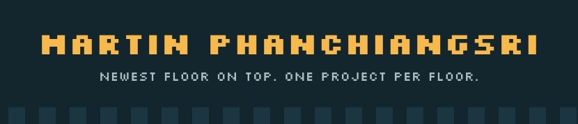
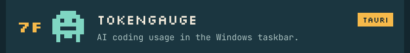
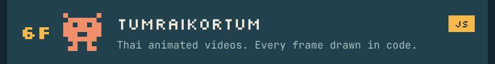
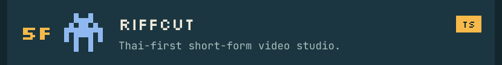
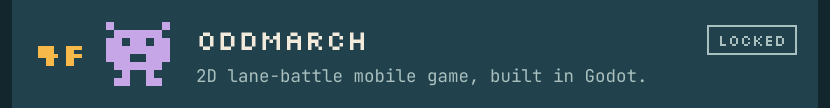
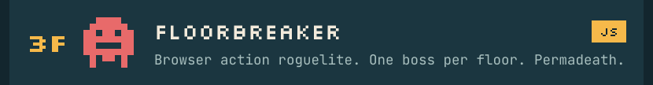
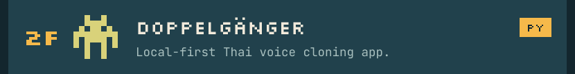
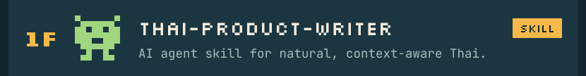

**Stack** · TypeScript · JavaScript · Python · Godot · Tauri · Docker · PostgreSQL · Redis

**Earlier runs** · [Final_Project_DeepLearning](https://github.com/Martinnezsavemaiwai/Final_Project_DeepLearning) · [sut-se-tourjeans](https://github.com/Martinnezsavemaiwai/sut-se-tourjeans) · [System-Analysis](https://github.com/Martinnezsavemaiwai/System-Analysis) · [Cloud-Assignment2](https://github.com/Martinnezsavemaiwai/Cloud-Assignment2)

Text version

- [TokenGauge](https://github.com/Martinnezsavemaiwai/TokenGauge): AI coding usage in the Windows taskbar.
- [TumraiKortum](https://github.com/Martinnezsavemaiwai/tumrai-kortum): Thai animated videos. Every frame drawn in code.
- [Riffcut](https://github.com/Martinnezsavemaiwai/Riffcut): Thai-first short-form video studio.
- Oddmarch (private): 2D lane-battle mobile game, built in Godot.
- [Floorbreaker](https://github.com/Martinnezsavemaiwai/Floorbreaker): Browser action roguelite. One boss per floor. Permadeath.
- [Doppelgänger](https://github.com/Martinnezsavemaiwai/Doppelg-nger): Local-first Thai voice cloning app.
- [thai-product-writer](https://github.com/Martinnezsavemaiwai/thai-product-writer): AI agent skill for natural, context-aware Thai.

